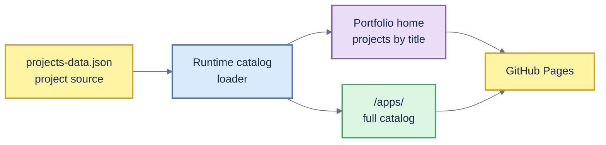

# thangldw.github.io

[English](#english) · [Tiếng Việt](#tiếng-việt) · [日本語](#日本語)

A dependency-light portfolio, application catalog, and static application host deployed with GitHub Pages.



## English

### Purpose and operating model

`thangldw.github.io` is a static personal portfolio and application host. GitHub Pages hosts the static shell. Root-site maintenance does not require a package-manager build, while generated apps are built in their source repositories. GitHub Pages serves committed HTML, CSS, JavaScript, JSON, fonts, images, and generated application artifacts.

- Production: [https://thangldw.github.io/](https://thangldw.github.io/)
- Default branch: `master`
- Runtime: standards-based browser APIs
- Deployment: GitHub Pages from the repository root
- Analytics: shared local script included once on every page, except study apps with an explicit no-tracking policy

### Public routes

| Route | Responsibility | Source of truth |
| --- | --- | --- |
| `/` | Portfolio profile and projects sorted by title | Root HTML plus shared project catalog |
| `/apps/` | Application catalog grouped by purpose | `js/projects-data.json` |
| `/japan-pr-guide/` | Standalone permanent-residence planning tool | Route-local static assets |
| `/ragops/`, `/proofline/`, `/awesome-maintainer-defense/`, `/macinity/`, `/kakeflow/` | Product introductions | Portfolio shell or canonical product source |
| `/404.html` | GitHub Pages fallback | Repository source |

Redirect stub pages (for example the former `/apps/ragops/`) are not allowed; link to the canonical route directly. `scripts/validate_site.py` fails on any `<meta http-equiv="refresh">` page.

The Cloudflare Workers study apps (Kotonari `https://kotonari.cert-apps.workers.dev/`, Claude Cert Prep `https://claude.cert-apps.workers.dev/`, G検定 Prep `https://gkentei.cert-apps.workers.dev/`, PMP Cert Prep `https://pmp.cert-apps.workers.dev/`) are not served from this domain; there are no `/kotonari/`, `/bjt/`, `/g/`, `/pmp/` or `/guide/` routes here. JETRISE (`/jetrise/`) and BizRoll (`/bizroll/`) publish from separate project repositories. Update the owning source and validate its release artifact before publication. Pages deployment status records publication. The project CI or local release receipt records application-level validation.

Every sitemap route must have canonical metadata, a meaningful description, required Open Graph fields, and a valid local social image where applicable.

### Shared catalog architecture

`js/projects-data.json` is the only durable source for project metadata. `js/projects-data.js` validates and loads it at runtime with revalidation. Both the home page and `/apps/` wait for the same readiness promise before rendering.

### Repository layout

```text
thangldw.github.io/
├── index.html
├── 404.html
├── apps/
│   └── index.html
├── japan-pr-guide/           # Generated Japan PR Guide app
├── assets/                    # Social images and local fonts
│   └── fonts/licenses/        # Upstream font notices and provenance
├── css/                       # Tokens, shared shell, and route styles
├── js/
│   ├── projects-data.json     # Project metadata source of truth
│   ├── projects-data.js       # Runtime loader and schema guard
│   └── shared behavior
├── scripts/                   # Static audits and browser smoke tests
├── robots.txt
└── sitemap.xml
```

### Local development

Requirements:

- Python 3.10 or later
- Node.js 22 or later
- Google Chrome at the standard macOS path, or `CHROME_BIN` pointing to a compatible executable

No dependency installation is required.

```bash
python3 -m http.server 4173
```

Open [http://localhost:4173/](http://localhost:4173/). Use a local server rather than opening files directly because runtime JSON loading requires HTTP.

### Quality gates

```bash
python3 scripts/audit_ui_standards.py
python3 scripts/validate_design_system.py
python3 scripts/validate_site.py
python3 scripts/test_site_audits.py
node scripts/test_homepage.mjs
node scripts/test_project_catalog.mjs
node scripts/smoke_brand.mjs
node scripts/smoke_product_pages.mjs
```

| Gate | Coverage |
| --- | --- |
| UI audit | Shared shell, design tokens, contrast, accessibility conventions, and prohibited presentation debt |
| Site validator | HTML parsing, local links, Markdown policy, JSON contracts, analytics, sitemap, canonical and social metadata |
| Browser smoke suite | Project JSON loading, catalog layout, theme controls, navigation, and responsive behavior |

Tests use isolated temporary servers and Chrome profiles and remove them after completion.

### Updating projects

Edit only `js/projects-data.json`.

1. Keep IDs unique and stable.
2. Provide all required catalog fields and a safe destination URL.
3. The home page includes all current projects in title order (English collation, numeric titles first). Keep `featured` metadata for other consumers.
4. Run validation and browser smoke tests.
5. Commit and push.

Home preserves the complete one-page profile, working approach, languages, contact links, and a side-project carousel that shows all `featured` projects in a fresh random order on each load, auto-rotating every 7 s with a pause/resume button (rotation stops on hover, focus, manual navigation, or `prefers-reduced-motion`). The full catalog uses compact cards of equal height, search, and group filters for Engineering, Utilities, Learning, and Experiments via `catalogGroup`. `catalogDescription` optionally supplies concise catalog copy. Email contacts use `mailto:`. Shared click events record only fixed project IDs and page locations.

Do not duplicate project descriptions in `index.html` or `apps/index.html`. The JSON loader uses `cache: "no-store"`, so content updates do not require changing HTML cache keys. Loader/schema cache keys change only when loader behavior changes.

### Support dialog and asset provenance

All HTML pages load the shared support assets with cache version `20261105-qr`; the Japan PR Guide exporter preserves this integration. Run `node scripts/smoke_support_site.mjs` to check all content pages on desktop and mobile.

The support button follows the active HTML language (EN/VI/JA/ZH), updates on language changes, and falls back to English for unsupported languages. Run `node scripts/smoke_support_locales.mjs` to verify route-wide language updates and regional language codes.

Home (sidebar) and Apps (header) mount the support trigger inline through `<div id="supportSlot">`, so neither page has a floating button. Portfolio support components inherit canonical tokens through `site-shell.css`. Independent project sites use the isolated `support-tokens.css` export so their host palette remains unchanged. Regenerate that file with `python3 scripts/generate_support_tokens.py` after editing `tokens.css`; the design validator rejects any export that differs from its canonical source.

The support trigger is text-only with a `--color-support` background and `--color-on-support` text (white on `#b83a06`, 5.8:1). The previously used Ko-fi cup asset is retained for cached versions.

The shared Support dialog shows the user-supplied local Ko-fi QR (`assets/support-kofi.png`) and ShopeePay QR, labeled Global and Vietnam. The Ko-fi QR decodes to `https://ko-fi.com/F4N224DDUV/?ref=qr&v=2`. There is no Ko-fi iframe or external script request. Both QR codes remain visible on desktop and mobile; headings are not interactive. Restricted study pages use the same local images without changing their CSP. The static site does not collect payment credentials.

The portfolio home includes an optional Support dialog. Ko-fi uses a local QR image, and Vietnamese wallet support uses the user-supplied `assets/support-shopeepay.jpg` image. Keep payment destinations explicit, never collect payment credentials in this static site, and verify the QR destination before every release that changes the image.

Self-hosted font provenance and upstream license texts live under `assets/fonts/licenses/`. `scripts/validate_site.py` permits only these durable license documents plus the root README; temporary Markdown reports and QA screenshots must stay outside the repository.

### Deployment and rollback

GitHub Pages publishes the `master` branch root directly (Settings → Pages → Source: *Deploy from a branch*); `.nojekyll` serves the tree as-is. There is no GitHub Actions workflow in this repository, so nothing validates a push remotely: run `python3 scripts/validate_site.py` before pushing to `master`. After merging, confirm the deploy in the Actions tab ("pages build and deployment") or check the `last-modified` header of `https://thangldw.github.io/`; changing the Pages source does not build by itself, only a push to `master` does.

Because the whole tree is served, internal paths (`_sources/`, `docs/`, `scripts/`, `*.md`) are reachable by URL even though nothing links to them. `robots.txt` disallows them for crawlers, which keeps them out of search indexes but does not restrict access. Making them genuinely private requires deploying a filtered artifact (Pages source *GitHub Actions*) instead of the repository root.

1. Start from a clean working tree and review all generated changes.
2. Run every relevant quality gate.
3. Commit a focused change and push `master`.
4. Monitor GitHub Pages until its state is `built`.
5. Verify production HTML, JSON responses, and critical rendered content.

Do not silently replace generated assets in an unrelated commit. If production is broken, revert the focused commit or publish a corrective commit, rerun validation, and verify deployment again. Avoid force pushes.

### Security and privacy

- Never commit secrets, credentials, private datasets, learner backups, or machine-specific paths.
- Keep fonts and production assets local; external font dependencies are rejected.
- Validate all JSON before rendering and escape catalog text inserted into HTML.
- Keep question banks out of Pages; controlled content requires network access. Browser-visible material remains copyable.
- Certification learner data remains in browser storage; the website does not collect or synchronize it.
- Analytics must not run on study pages declaring `data-analytics="off"`; it must appear exactly once elsewhere. Learning exports retain their restrictive CSP and no-tracking policy.

### Contribution policy

Keep changes route-focused, accessible, responsive, and independently verifiable. Shared visual behavior belongs in tokens or shared styles rather than inline presentation. New routes require sitemap, canonical, Open Graph, social-image, analytics, validation, and smoke-test updates.

## Tiếng Việt

### Mục đích và mô hình vận hành

`thangldw.github.io` là portfolio và host ứng dụng tĩnh. Pages host shell tĩnh; nội dung chứng chỉ được API Cloudflare bên ngoài cấp có kiểm soát. Root website không cần bước build bằng package manager; app đã sinh được build tại repo source riêng. GitHub Pages phục vụ trực tiếp HTML, CSS, JavaScript, JSON, font, ảnh và artifact ứng dụng đã sinh.

- Production: [https://thangldw.github.io/](https://thangldw.github.io/)
- Default branch: `master`
- Runtime: API chuẩn của trình duyệt
- Deploy: GitHub Pages từ root repository

### Route công khai

| Route | Trách nhiệm | Nguồn chuẩn |
| --- | --- | --- |
| `/` | Portfolio và các dự án theo thứ tự tên | Root HTML và catalog project dùng chung |
| `/apps/` | Danh mục ứng dụng có search/filter | `js/projects-data.json` |
| `/japan-pr-guide/` | Công cụ lập kế hoạch thường trú | Static asset riêng của route |
| `/404.html` | Fallback của GitHub Pages | Source repository |

Mọi route trong sitemap phải có canonical, description, Open Graph và social image hợp lệ khi cần.

### Kiến trúc catalog dùng chung

`js/projects-data.json` là nguồn duy nhất cho metadata project. Loader kiểm tra và fetch JSON ở runtime; trang chủ và `/apps/` cùng chờ một readiness promise trước khi render.

### Cấu trúc và phát triển local

Dùng cây thư mục ở phần English. Cần Python 3.10+, Node.js 22+ và Chrome. Không cần cài dependency.

```bash
python3 -m http.server 4173
```

Mở [http://localhost:4173/](http://localhost:4173/). Phải dùng HTTP server vì browser fetch JSON ở runtime.

### Cổng chất lượng

Chạy UI audit, site validator và browser smoke suite bằng các command trong phần English. Các gate kiểm tra shared shell, token/contrast/accessibility, link và metadata, contract JSON, analytics, sitemap, project loader, theme và responsive layout.

### Cập nhật project

Chỉ sửa `js/projects-data.json`. Giữ ID duy nhất/ổn định, khai báo đủ field và URL an toàn, giữ `featured` cho các nơi còn sử dụng. Trang chủ sắp xếp theo tên với English collation và numeric ordering. Chạy validation/smoke test và push. Không copy description vào HTML. Content JSON dùng `cache: "no-store"`, nên không cần đổi cache key HTML mỗi lần.

### Support và nguồn gốc asset

Trang chủ có dialog Support tùy chọn. Ko-fi dùng ảnh QR local, và ủng hộ qua ShopeePay dùng ảnh local `assets/support-shopeepay.jpg`. Website tĩnh không thu thập thông tin thanh toán. Phải xác minh người nhận QR trước mỗi release thay đổi ảnh. Hồ sơ nguồn và license font tự host nằm trong `assets/fonts/licenses/`; report Markdown và ảnh QA tạm không được commit.

### Deploy, bảo mật và đóng góp

Luôn bắt đầu từ working tree sạch, kiểm tra generated diff, chạy test, commit tập trung, push `master`, chờ Pages deploy và xác minh HTML/JSON/UI production. Nếu lỗi, revert commit tập trung hoặc tạo corrective commit; không force-push.

Không commit secret, credential, private dataset, learner backup hoặc đường dẫn máy. Font và asset phải local. JSON phải được validate và text phải escape trước khi chèn HTML. Bank không được deploy lên Pages; API cần kết nối mạng và nội dung đã hiển thị vẫn có thể sao chép. Dữ liệu học nằm trong browser storage và không được website đồng bộ.

Thay đổi cần tập trung theo route, accessible, responsive và test được. Route mới phải cập nhật sitemap, canonical, Open Graph, social image, analytics, validation và smoke test.

## 日本語

### Purpose と operating model

`thangldw.github.io` は static portfolio と application host です。Pages は static shell を host します。Root site 自体は package-manager build 不要ですが、generated app は各 source repo で build します。GitHub Pages が committed HTML、CSS、JavaScript、JSON、font、image、generated artifact を配信します。

- Production: [https://thangldw.github.io/](https://thangldw.github.io/)
- Default branch: `master`
- Runtime: standard browser API
- Deployment: repository root から GitHub Pages

### Public route

| Route | Responsibility | Source of truth |
| --- | --- | --- |
| `/` | Portfolio とタイトル順のプロジェクト | Root HTML と shared project catalog |
| `/apps/` | Search/filter 可能な application catalog | `js/projects-data.json` |
| `/japan-pr-guide/` | 永住計画 tool | Route-local static asset |
| `/404.html` | GitHub Pages fallback | Repository source |

The Cloudflare Workers study apps (Kotonari `https://kotonari.cert-apps.workers.dev/`, Claude Cert Prep `https://claude.cert-apps.workers.dev/`, G検定 Prep `https://gkentei.cert-apps.workers.dev/`, PMP Cert Prep `https://pmp.cert-apps.workers.dev/`) are not served from this domain; there are no `/kotonari/`, `/bjt/`, `/g/`, `/pmp/` or `/guide/` routes here. JETRISE (`/jetrise/`) and BizRoll (`/bizroll/`) publish from separate project repositories. Update the owning source and validate its release artifact before publication. Pages deployment status records publication. The project CI or local release receipt records application-level validation.

Sitemap route には canonical、description、Open Graph、必要な social image を設定します。

### Shared catalog architecture

`js/projects-data.json` が project metadata の唯一の source です。Loader が runtime に validation/fetch し、home page と `/apps/` は同じ readiness promise 後に render します。

### Local development と quality gate

English セクションの directory tree を参照してください。Python 3.10+、Node.js 22+、Chrome が必要です。Dependency install は不要です。

```bash
python3 -m http.server 4173
python3 scripts/audit_ui_standards.py
python3 scripts/validate_site.py
```

JSON runtime loading のため file を直接開かず HTTP server を使います。Quality gate は shared shell、token、contrast、accessibility、link、metadata、JSON contract、analytics、sitemap、catalog loading、theme、responsive behavior を確認します。

### Project の更新

Project metadata は `js/projects-data.json` だけで編集します。Stable unique ID、required field、安全な URL を設定します。ホームは英語の照合順で数値を考慮してタイトルを並べます。`featured` は他の利用箇所のために保持し、テスト後に push します。JSON content update のたびに HTML cache key を変える必要はありません。

Home の optional Support dialog は local Ko-fi QR、local ShopeePay QR を使用します。Static site は payment credential を収集しません。QR image を変更する release では recipient を検証します。Self-hosted font の provenance と upstream license は `assets/fonts/licenses/` に保存し、temporary report と QA screenshot は repository に commit しません。

### Deployment、security、contribution

Clean working tree、generated diff review、全 test、focused commit、`master` push、Pages completion、production HTML/JSON/UI verification の順で進めます。障害時は focused revert または corrective commit を使い、force-push を避けます。

Secret、credential、private dataset、learner backup、machine-specific path を commit しません。Font/asset は local に置き、JSON を validate し、HTML 挿入前に text を escape します。Bank は Pages に配置しません。API content は network 接続を必要とし、表示済み content のコピーを防止する保証はありません。Learner data は browser storage 内に留まります。

変更は route-focused、accessible、responsive、independently verifiable にします。新 route では sitemap、canonical、Open Graph、social image、analytics、validation、smoke test を更新します。

## Canonical homepage design — 2026-10-10

The homepage is the design reference for `/apps/` and the application catalog. Maintain each application shell in its owning source repository.

- Visual register: minimal portfolio, restrained separators, no decorative cards.
- Light default on every homepage load; dark mode is an explicit user action. Use the shared `site-shell.js` theme control and `themechange` event.
- Canonical runtime token owner: `css/tokens.css`; shared recipes: `css/site-shell.css`; full contract: [DESIGN.md](DESIGN.md). Light: canvas `#ffffff`, text `#23291f`, muted `#535e4b`, accent `#965025`, border `#d1d7c9`, controls `#e9ede3`. Dark: canvas `#11150e`, text `#e5e6df`, muted `#b9bdb5`, accent `#e69d6b`, border `#32382d`, controls `#20261c`. Home and Apps consume the same tokens; generated Cert receives shared shell and catalog aliases through the existing integration stylesheet.
- Typography: self-hosted Inter for Latin scripts; Japanese and Chinese use script-capable system stacks. Desktop main body stays at 14px (compact density), with 16px mobile prose. No clipped content or forced hidden document overflow.
- Layout: sidebar plus fluid main column, About paragraphs fill the available column and wrap naturally. At wider screens the frame grows to 1800px. Mobile reflows vertically.
- Language: EN/VN/JP/CN buttons; English default, locale applies to owned copy, project descriptions, accessibility labels, and document language. Proper names remain unchanged. Japanese uses consistent polite prose; Chinese uses Simplified Chinese. This is a global technical portfolio with multilingual support, not a Japan-only regulated service.
- Project source: existing shared catalog loader. Home shows `featured` projects in a carousel shuffled once per load (5/3/2/1 visible by width), auto-rotating with a pause/resume control; the full A–Z catalog lives at `/apps/`.
- The homepage envelope opens Gmail’s web composer directly for `thangldw@gmail.com`.
- Cross-route adoption: reuse these semantic colors, typography, brand, theme, language, focus, and spacing contracts when adapting `/apps/` and other application sources. Preserve route-specific information architecture and application behavior.

Homepage runtime files are `index.html`, `css/homepage.css`, `js/homepage.js`, `js/home-locales.mjs`, and `js/home-project-order.mjs`. No production package installation or build is required.

Technical standardization is enforced by `scripts/validate_design_system.py`, also invoked by the site validator. It checks light/dark token/document drift, typography and palette literals in native route CSS, shared logo/control states, and Home/Apps/Cert integration. Generated assessment internals retain their source-owned styles until that workflow is migrated; generated bundles are never edited by the portfolio release.

Official CSS entry point: `css/site-shell.css` → `css/tokens.css`. Every public route inherits this foundation; page CSS owns composition. Core token redefinition anywhere in authored `css/` is rejected by the design validation gate. See [mandatory inheritance contract](DESIGN.md#mandatory-inheritance-contract).


### Retired study publishing — 2026-11-06

The former study library and its generated routes, public metadata, learning workspace, and content APIs are retired. Keep its source data and archived artifacts in the private source repository. Do not restore the retired routes, shared bundles, catalog discovery, or Cloudflare deployments during routine portfolio publication. Kotonari and Claude Cert Prep publish independently.

Thư viện ôn thi cũ, các route sinh tự động, metadata công khai, workspace học tập và content API đã ngừng công bố. Dữ liệu và archive chỉ lưu trong repo nguồn private. Không khôi phục các thành phần này khi publish portfolio. Kotonari và Claude Cert Prep tiếp tục publish độc lập.

旧学習ライブラリの生成ルート、公開メタデータ、学習ワークスペース、content API は公開を終了しました。データとアーカイブは非公開のソースリポジトリで管理し、通常の portfolio 公開時に復元しないでください。Kotonari と Claude Cert Prep は独立して公開します。
